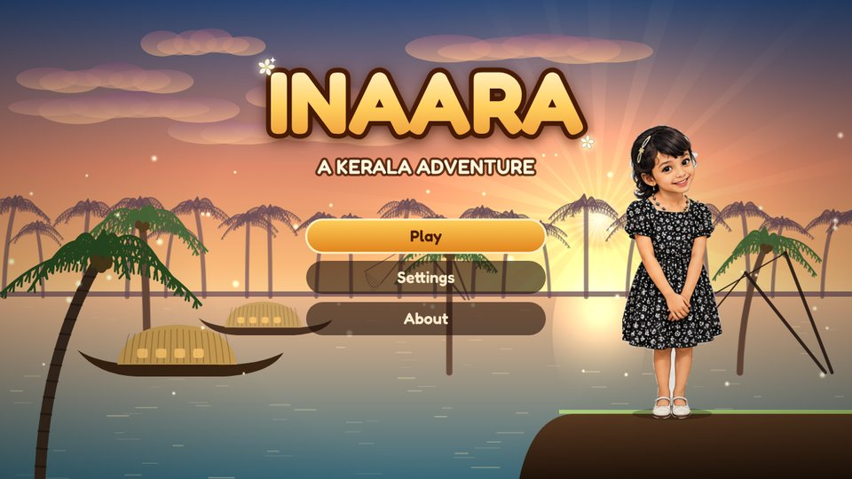
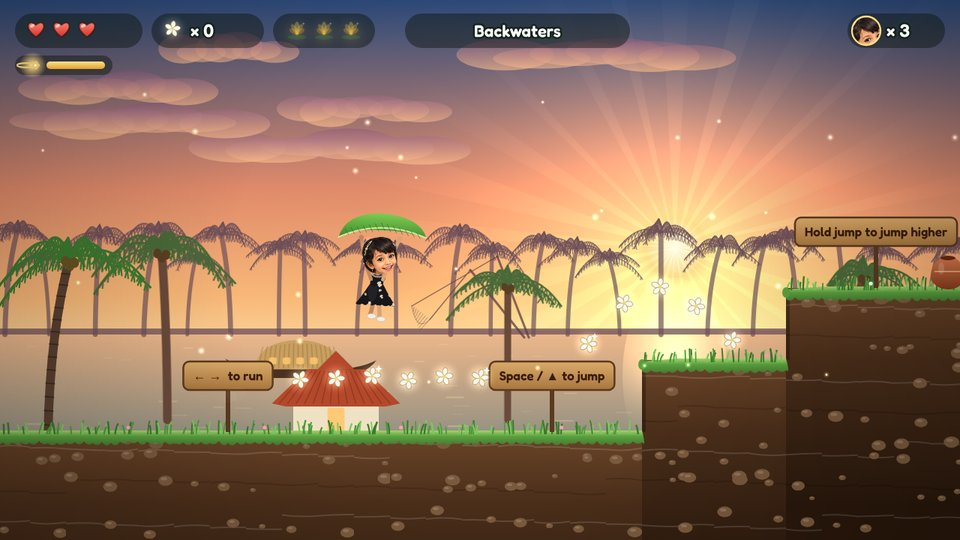
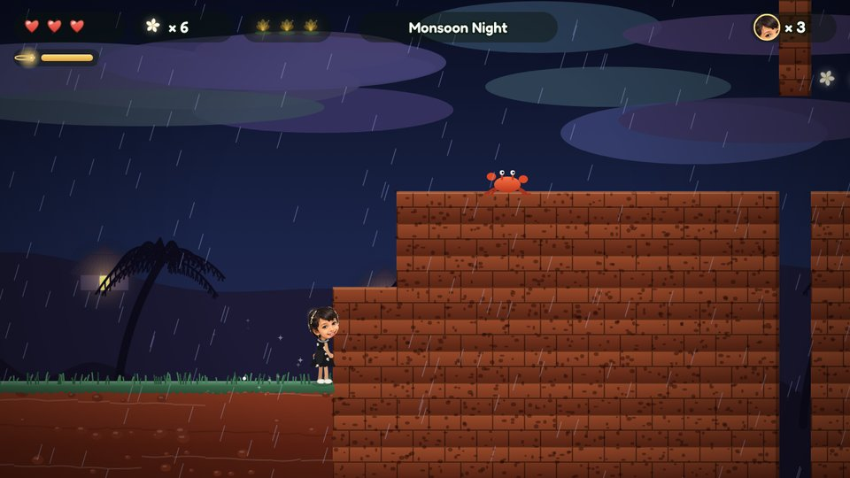

# Inaara: a Kerala adventure

Run, jump, spin and glide through Kerala with Inaara! Gather jasmine flowers, find the hidden golden lotuses,
and get the festival garland back from the cheeky Monkey Chief.

**[▶ Play Inaara](https://azeembukhariprivate.github.io/inaara/)** — free, in your web browser, on a computer or a phone.
Nothing to download.



## The adventure

| | Place | What's new |
|---|---|---|
| 1 | Backwaters | Learn to run, jump, spin and glide past houseboats at sunset |
| 2 | Munnar Tea Hills | Climb the misty tea gardens, watch out for monkeys |
| 3 | Rainforest Falls | Glide into the waterfall's mist to float up high |
| 4 | Monsoon Night | Jump from wall to wall up the red cliffs in the rain |
| 5 | The Boat Race | Keep ahead of the racing snake boats |
| 6 | The Monkey Chief | Wait until he's dizzy, then bonk him! |

Every 100 jasmine flowers make a garland: one more try. Brass lamps along the way keep your place and fill up your hearts.
Each level hides three golden lotuses. No creature is ever hurt: bonked monkeys, crows and crabs just tumble away.



## How to play

| | Keyboard | Phone or tablet | Game controller |
|---|---|---|---|
| Run | ← → (or A D) | ◀ ▶ | D-pad or stick |
| Jump (hold to go higher) | Space, Z or K | JUMP | A |
| Glide with the banana leaf | keep holding jump while falling | keep holding JUMP | keep holding A |
| Spin (when the hair clip glows) | X, Shift or J | SPIN | X or B |
| Drop through a plank | ↓ | ▼ | down |
| Pause | Esc or P | II | Start |

Jump against a wall and jump again to leap off it. Jump at a ledge to grab it, then jump or press up to climb.

On a phone, hold it sideways. The game goes full screen when you first tap.

## Keep it on your phone or computer

Inaara works without the internet once it has been opened. To get an icon for it:

- **Android (Chrome):** open the game, tap the ⋮ menu, then **Add to Home screen** (or **Install app**).
- **iPhone or iPad (Safari):** open the game, tap the Share button, then **Add to Home Screen**.
- **Computer (Chrome or Edge):** open the game and click **Install** in the address bar, or use **Install on this device** on the title screen.

Your progress is kept in your browser on that device.



## Made in code

Every picture, every tune and every sound in Inaara is made by the game's own code as you play, in the style of
Kerala: chenda drums, flute, temple bells and a drone, using Carnatic-style scales. The only outside piece is the
Fredoka font. Inaara's face comes from her own pictures, shared by her family.

## Build it yourself

You need [Node.js](https://nodejs.org) 22 or newer. There's nothing to install for the game itself.

```
npm run serve          # then open http://localhost:8080/
npm test               # checks the game rules, and that every level can be finished
npm run test:browser   # plays the game in a browser (needs Playwright)
```

`tools/make-icons.mjs` makes the app icons and `tools/cut_faces.py` cut Inaara's faces from her picture sheet.
Each push to `main` is tested and then put online by GitHub Actions.

## Licence

The code is free and open source under the MIT licence (see [LICENSE](LICENSE)). The pictures of Inaara's face are
not part of that licence and may not be reused elsewhere. The Fredoka font uses the SIL Open Font License
(see [THIRD-PARTY-NOTICES.txt](THIRD-PARTY-NOTICES.txt)).

Made by Azeem, with Claude and ♥
